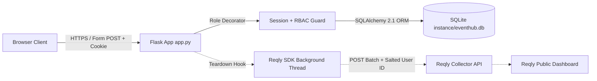
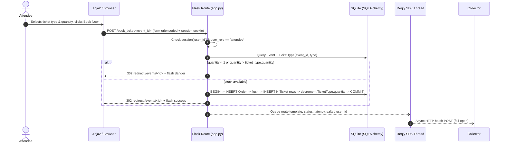
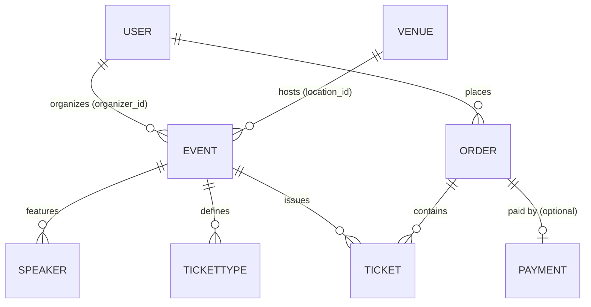

# EventFlow — Architecture

---

## 1. Stack & Runtime Versions

| Layer | Technology & Exact Version | Runtime / Region / Notes |
|---|---|---|
| Framework | Python (CI `3.12`, `3.9+` compatible) · Flask `>=3.1.3` · Werkzeug `>=3.1.9` | Server-rendered Jinja2 `3.1.6` templates; `start.py` serves on `$PORT` (default `5000`) |
| UI & Styling | Plain CSS (`static/css/style.css`, `#008080` teal theme) · Vanilla JS (`static/js/`) | 13 Jinja2 templates extending `templates/layout.html` |
| Auth & Sessions | Signed Flask cookie sessions (`SECRET_KEY`) · `bcrypt>=5.0.0` | Per-password `bcrypt.gensalt()` hashes; `@login_required` & `@organizer_required` |
| Database & ORM | SQLite · Flask-SQLAlchemy `3.1.1` · SQLAlchemy `2.1.8` | Local `instance/eventhub.db` created by `db.create_all()` at boot |
| Observability | Reqly Python SDK (`reqly>=0.7.1`) | Background thread batching; fail-open; HMAC consumer hashing via `REQLY_CONSUMER_SALT` |
| Hosting & WSGI | Render free web service (`render.yaml`, Oregon) · `gunicorn>=26.2.0` installed | `start.py` initializes DB + demo accounts then runs Flask server |
| CI & Security | `pytest` · `python -m compileall` · CodeQL · Gitleaks · Dependency Review | Automated via `.github/workflows/` targeting `master` |

---

## 2. System Topology & Components



```text
EventFlow/
  app.py                  # Flask app: SQLAlchemy models, RBAC decorators, 25 routes, Reqly setup (787 lines)
  start.py                # Boot entrypoint: db.create_all(), organizer_id column check, demo seed, HTTP server
  create_admin_users.py   # Idempotent seeder for administrator, organizer, and attendee demo accounts
  config.py               # Environment config classes (DevelopmentConfig, TestingConfig, ProductionConfig)
  schema_sqlite.sql       # Reference SQLite DDL including 7 secondary indexes
  render.yaml             # Render Blueprint (Python web service, Oregon, free tier, Reqly env vars)
  templates/              # 13 Jinja2 views (layout.html base + 12 page/form templates)
  static/                 # style.css, favicon.ico, script.js, event-validation.js
  tests/test_smoke.py     # 5 end-to-end pytest smoke tests against isolated temp SQLite DB
```

### Boot & Seeding (`start.py`, `create_admin_users.py`)
`start.py` runs `db.create_all()` inside `app.app_context()`, inspects the `event` table to add `organizer_id` via `ALTER TABLE` if booting against an older SQLite file, calls `create_admin_users()` idempotently, and binds `0.0.0.0:$PORT` with `debug=False`.

### Access Control (`login_required`, `organizer_required`)
Every protected route checks `session['user_id']`, loads the `User` row from SQLite, and evaluates `user.user_type`. Unauthenticated requests redirect (`302`) to `/login`; insufficient roles redirect (`302`) to `/`. `administrator` passes every role check, `organizer` passes `organizer` and `attendee` checks on decorator-guarded routes, and `book_ticket` checks `session.get('user_role') == 'attendee'` directly.

### Reqly Instrumentation (`app.py`)
`reqly.instrument(app, service_name="eventflow", consumer=reqly_consumer)` hooks Flask's request lifecycle. `reqly_consumer` extracts `session.get('user_id')`; the SDK hashes it with `REQLY_CONSUMER_SALT`, attaches `REQLY_ENVIRONMENT` and `RENDER_GIT_COMMIT`, and flushes telemetry asynchronously from a background thread.

---

## 3. End-to-End Request Flow (Ticket Booking & Cancellation)



1. **Trigger:** Attendee submits the booking form on `/events/<event_id>` to `POST /book_ticket/<event_id>`.
2. **Auth & Validation:** Route verifies `user_id` in session, `user_role == 'attendee'`, `TicketType` existence, and `1 <= quantity <= ticket_type.quantity`.
3. **Persistence:** Inside a single SQLAlchemy transaction, `Order` is created and flushed for `order_id`, `quantity` `Ticket` records are inserted, and `TicketType.quantity` is decremented.
4. **Failure Rollback:** Any exception triggers `db.session.rollback()`, logs via `app.logger.error(...)`, and flashes a safe error banner.
5. **Telemetry:** Regardless of outcome, Reqly records route template latency and status asynchronously without adding network latency to the HTTP response.

---

## 4. Database Schema & Indexing



| Model / Table | Key Columns & Types | Constraints / Relations | Purpose |
|---|---|---|---|
| `User` (`user`) | `user_id (int PK)`, `name (str 255)`, `email (str 255)`, `password (str 255)`, `user_type (str 20)` | `UNIQUE(email)` · `CHECK user_type IN ('organizer','attendee','administrator')` | Account credentials & RBAC role |
| `Venue` (`venue`) | `venue_id (int PK)`, `name (str 255)`, `address (text)`, `capacity (int)`, `city/state/zip_code` | Delete blocked in app if linked events exist | Physical venue metadata & capacity cap |
| `Event` (`event`) | `event_id (int PK)`, `name`, `description`, `date`, `time`, `location_id (FK)`, `organizer_id (FK)` | `FK location_id -> venue(venue_id)` · `FK organizer_id -> user(user_id)` | Published event record |
| `Speaker` (`speaker`) | `speaker_id (int PK)`, `name (str 255)`, `bio (text)`, `event_id (FK)` | `FK event_id -> event(event_id)` | Event speakers |
| `TicketType` (`tickettype`) | `ticket_type_id (int PK)`, `event_id (FK)`, `type (str 50)`, `price (numeric 10,2)`, `quantity (int)` | `FK event_id -> event(event_id)` | Priced tier + live remaining inventory |
| `Order` (`order`) | `order_id (int PK)`, `user_id (FK)`, `date (datetime)`, `total_price (numeric 10,2)`, `payment_id (FK)` | `FK user_id -> user(user_id)` · `FK payment_id -> payment(payment_id)` | Attendee booking order header |
| `Ticket` (`ticket`) | `ticket_id (int PK)`, `event_id (FK)`, `order_id (FK)`, `price (numeric 10,2)`, `type (str 50)`, `seat_number (int)` | `FK event_id -> event(event_id)` · `FK order_id -> order(order_id)` | Issued per-seat ticket rows |
| `Payment` (`payment`) | `payment_id (int PK)`, `order_id (FK)`, `payment_method (str 20)`, `transaction_id (str 255)` | `UNIQUE(order_id)` | Reserved for v2 Stripe checkout |

**Indexing & Schema Divergence Note:**
- `schema_sqlite.sql` defines 7 secondary indexes (`idx_user_email`, `idx_event_date`, `idx_order_user`, `idx_ticket_event`, `idx_ticket_order`, `idx_speaker_event`, `idx_tickettype_event`).
- Runtime startup uses SQLAlchemy `db.create_all()` in `app.py` / `start.py`, which currently creates primary keys and unique constraints (`user.email`, `payment.order_id`) without `index=True` on foreign keys or `Event.date`. Adding `index=True` (or executing the index DDL) eliminates full table scans as rows grow beyond ~10K records.

---

## 5. Caching, State & Concurrency Control

- **Caching strategy:** None — direct SQLite reads per request via SQLAlchemy; user identity (`user_id`, `user_name`, `user_role`) lives in signed Flask session cookies (`itsdangerous`).
- **Idempotency & duplicate prevention:** `User.email` unique constraint prevents duplicate signups (`IntegrityError` handled cleanly). Booking and cancel forms do not currently use idempotency keys or client submit locks.
- **Concurrency & transactions:**
  - `book_ticket` creates `Order`, N `Ticket` rows, and decrements `TicketType.quantity` in a single `db.session.commit()`.
  - `cancel_ticket` uses `db.session.begin_nested()` to increment `TicketType.quantity`, delete the `Ticket`, and update/delete the parent `Order` before committing.
  - **Known concurrency limit:** Stock checking (`quantity <= ticket_type.quantity`) happens in Python before the SQL `UPDATE`, so concurrent requests under multi-worker WSGI could oversell the final ticket without an atomic conditional `UPDATE ... WHERE quantity >= :qty`.

---

## 6. Observability & Telemetry (Reqly)

- **Instrumentation:** Single `reqly.instrument(app, service_name="eventflow", consumer=reqly_consumer)` hook in `app.py` instruments all 25 routes with zero per-route boilerplate.
- **Privacy & release tagging:** `reqly_consumer` returns `str(session.get('user_id'))` or `None`; the SDK hashes non-null IDs with `REQLY_CONSUMER_SALT` before queuing and captures route templates (`/events/<int:event_id>`) rather than raw payloads. Release SHAs come automatically from `RENDER_GIT_COMMIT`.
- **Fail-open guarantee:** Background thread queue retries transient collector errors and drops telemetry or self-disables on SDK exceptions so EventFlow stays operational even when `REQLY_COLLECTOR_URL` is unset or unreachable.

---

## 7. Route & Endpoint Contracts

| Method | Route | Auth & Ownership | Request / Form Params | Responses (`2xx` / `3xx` / `4xx`) |
|---|---|---|---|---|
| `GET` | `/favicon.ico` | Public | `—` | `200` static icon |
| `GET` | `/` | Public | `—` | `200` up to 6 upcoming events (`index.html`) |
| `GET` | `/events` | Public | `—` *(template renders unused `search`, `date` inputs)* | `200` all events sorted by date (`events.html`) |
| `GET` | `/events/<int:event_id>` | Public | Path `event_id`; optional `start_time`, `end_time` query | `200` event + ticket types · `404` missing |
| `GET, POST` | `/login` | Public | Form `email`, `password` | `200` form · `302` `/dashboard` (organizer) or `/` · flash on failure |
| `GET, POST` | `/signup` | Public | Form `name`, `email`, `password`, `confirm_password` *(role ignored)* | `200` form / validation error · `302` `/login` on create |
| `GET` | `/logout` | Any | `—` | `302` `/` with cleared session |
| `GET` | `/dashboard` | `@organizer_required` | `—` | `200` events, venues, speakers, tickets, orders · `302` unauthorized |
| `GET, POST` | `/events/create` | `@organizer_required` | Form `name`, `description`, `date`, `start_time`, `end_time`, `location_id`, `speakers[]` | `200` form · `302` `/dashboard` |
| `GET, POST` | `/events/<int:event_id>/edit` | `@organizer_required` | Path `event_id`; same form fields as create | `200` form · `302` `/dashboard` · `404` missing |
| `POST` | `/events/<int:event_id>/delete` | `@organizer_required` | Path `event_id` | `302` `/dashboard` · `404` missing |
| `GET, POST` | `/venues/create` | `@organizer_required` | Form `name`, `address`, `capacity`, `city`, `state`, `zip_code` | `200` form · `302` `/dashboard` |
| `GET, POST` | `/venues/<int:venue_id>/edit` | `@organizer_required` | Path `venue_id`; venue fields | `200` form · `302` `/dashboard` · `404` missing |
| `POST` | `/venues/<int:venue_id>/delete` | `@organizer_required` | Path `venue_id` | `302` `/dashboard` (blocked if `venue.events` non-empty) · `404` |
| `GET, POST` | `/speakers/create` | `@organizer_required` | Form `name`, `bio`, `event_id` | `200` form · `302` `/dashboard` |
| `GET, POST` | `/speakers/<int:speaker_id>/edit` | `@organizer_required` | Path `speaker_id`; `name`, `bio`, `event_id` | `200` form · `302` `/dashboard` · `404` missing |
| `POST` | `/speakers/<int:speaker_id>/delete` | `@organizer_required` | Path `speaker_id` | `302` `/dashboard` · `404` missing |
| `GET, POST` | `/events/<int:event_id>/tickets/manage` | `@organizer_required` | Path `event_id`; form `type`, `price`, `quantity` | `200` manage page · `302` same page (blocks if `> venue.capacity`) · `404` |
| `GET` | `/events/<int:event_id>/tickets` | `@login_required("organizer")` | Path `event_id` | `200` sold ticket list · `302` unauthorized · `404` |
| `POST` | `/tickets/<int:ticket_id>/delete` | `@login_required("organizer")` | Path `ticket_id` *(refers to `TicketType.ticket_type_id`)* | `302` `/events/<id>/tickets/manage` · `404` |
| `POST` | `/book_ticket/<int:event_id>` | Session + `user_role == 'attendee'` | Path `event_id`; form `ticket_type`, `quantity` | `302` `/events/<id>` (or `/login` if unauthorized) · `404` |
| `GET` | `/my-tickets` | `@login_required("attendee")` | `—` | `200` user's orders & tickets (`joinedload`) · `302` unauthorized |
| `POST` | `/tickets/<int:ticket_id>/cancel` | `@login_required("attendee")` + owner | Path `ticket_id` (`order.user_id == session['user_id']`) | `302` `/my-tickets` · `404` |
| `GET` | `/admin/organizers` | `@login_required("administrator")` | `—` | `200` organizers + event counts · `302` unauthorized |
| `POST` | `/admin/organizers/<int:user_id>/delete` | `@login_required("administrator")` | Path `user_id` (must be `'organizer'`) | `302` `/admin/organizers` · `404` |

---

## 8. Security Controls

- **Password & session security:** Passwords are salted and hashed with `bcrypt`. Sessions use Flask signed cookies; `SECRET_KEY` and `REQLY_*` secrets are injected via `.env` locally and Render environment variables in production.
- **Role & IDOR controls:** Public `/signup` hardcodes `user_type = 'attendee'`; protected routes enforce `@login_required` / `@organizer_required`; `/tickets/<id>/cancel` checks `order.user_id == session['user_id']`; `/admin/organizers/<id>/delete` validates `organizer.user_type == 'organizer'`.
- **SQL & XSS safety:** SQLAlchemy parameterized queries are used across all routes (`start.py` runs one static `ALTER TABLE` string); Jinja2 auto-escaping is enabled globally with no raw HTML rendering.
- **Telemetry privacy:** User IDs are HMAC-salted inside the Reqly SDK with `REQLY_CONSUMER_SALT`; request bodies and query parameters are never forwarded.
- **Known v1 security debt:** Forms do not currently include CSRF tokens (`Flask-WTF` absent); `app.py` falls back to `'default_secret_key'` if `SECRET_KEY` is omitted from env; organizer CRUD routes do not yet verify `event.organizer_id == session['user_id']`.

---

## 9. Error Handling, Reliability & Observability

| Failure Mode | System Behavior | Logged / Alerted |
|---|---|---|
| Duplicate email on `/signup` | `IntegrityError` caught, `db.session.rollback()`, friendly flash message | Flash alert to user |
| Exception during booking, cancel, or event/organizer delete | `db.session.rollback()`, flash danger alert, safe redirect | `app.logger.error(...)` on create/edit/book |
| Venue deletion while events exist | Guarded by `if venue.events:` before delete | Danger flash + button disabled in UI |
| Reqly collector down or slow | Retries batch in background thread, then drops batch cleanly | Warning logged by Reqly SDK |
| Reqly internal SDK error | Logs once and disables instrumentation automatically | App continues serving `200` |

---

## 10. Performance Budgets & Scale Ceilings

| Parameter / Limit | Current Configured Value | What Breaks at 10x / 100x Load | Next Scaling Step |
|---|---|---|---|
| Web server runtime | Single-process Flask server (`start.py`) | Blocking requests under concurrent users | Switch `start.py` / `render.yaml` to `gunicorn -w 2` (already in `requirements.txt`) |
| Database engine & disk | Local SQLite (`eventhub.db`) on Render container disk | Single-writer lock contention (`database is locked`) + ephemeral disk loss | Migrate `DATABASE_URL` to managed PostgreSQL + connection pooling + Alembic |
| List & dashboard queries | Unpaginated `.all()` on `/events` and `/dashboard` (`events`, `tickets`, `orders`) | High memory & slow template renders above ~5K–10K rows | Add SQLAlchemy `index=True` on FKs/dates + keyset or `LIMIT/OFFSET` pagination |
| Render free tier compute | 512 MB RAM · sleeps after 15m idle | ~30s cold start delay and OOM risk on large unpaginated responses | Paid always-on Render instance + query pagination |
| Reqly telemetry volume | Unthrottled (`REQLY_SAMPLE_RATE` unset = `1.0`) | Collector free-tier storage/CPU saturation at high RPS | Tune `REQLY_SAMPLE_RATE` (e.g. `0.25`) in production env |

---

## 11. Explicit Scope Cuts

- **Payment processing** — `Payment` model exists in schema and templates (`my_tickets.html` conditionally renders `order.payment`), but no route inserts `Payment` rows yet.
- **Schema migration runner** — `flask-migrate` was removed (`c49c935`); `start.py` handles the `event.organizer_id` column add via an explicit `ALTER TABLE` check.
- **Event time persistence** — `Event.start_time` and `Event.end_time` exist as in-memory `@property` wrappers around the single `Event.time` column rather than two separate DB columns.
- **Event filtering** — `templates/events.html` includes a `search` and `date` filter form submitting to `GET /events`, while `list_events()` currently returns all events unfiltered.

---

<div align="center">

<h3>Tanish Poddar</h3>

<a href="https://tanisheesh.in"></a>
<a href="https://linkedin.com/in/tanisheesh"></a>
<a href="https://github.com/tanisheesh"></a>
<a href="mailto:hi@tanisheesh.in"></a>

</div>
